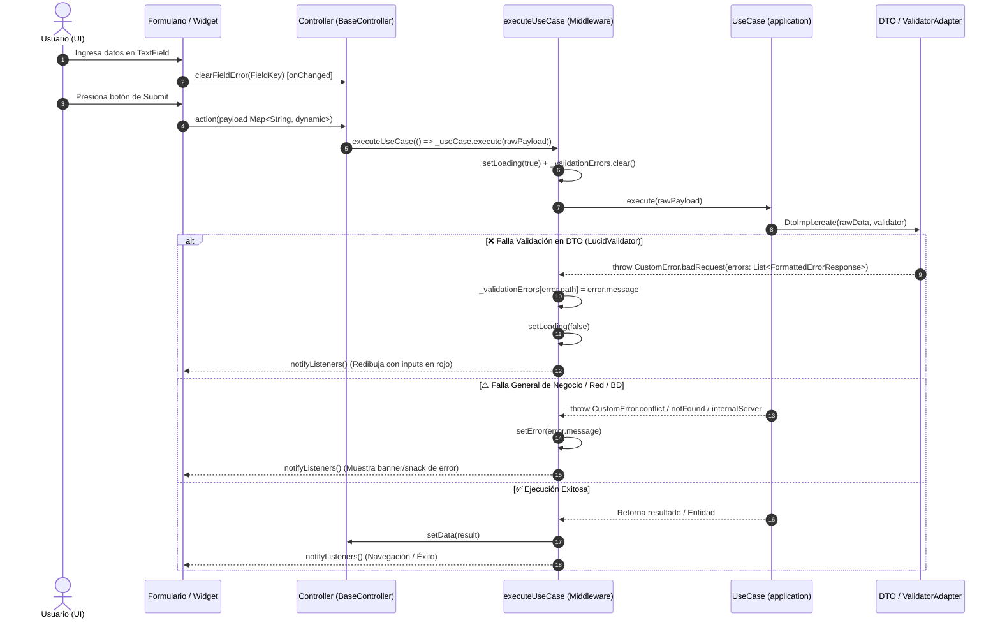

# 🎮 Skill: Consumo de Casos de Uso en Presentation (Tracknner)

Esta guía establece el estándar de desarrollo para la capa de **`presentation/`** en Tracknner al consumir Casos de Uso existentes. Define cómo orquestar la ejecución desde controladores reactivos (`BaseController`), cómo interceptar automáticamente los fallos de validación provenientes de los DTOs y cómo conectarlos con formularios y widgets pasivos en Flutter.

> [!IMPORTANT]
> **ALCANCE EXCLUSIVO DE LA CAPA DE PRESENTACIÓN:**
> Esta skill se enfoca **únicamente** en la capa de `presentation/` (controladores, vistas, formularios y widgets). **No** se deben modificar ni crear DTOs, casos de uso ni repositorios durante este flujo; estos componentes actúan como contratos dados del sistema.

---

## 🧭 Flujo Arquitectónico del State Middleware



---

## 🧩 1. Estructura y Funcionamiento de los Contratos de Entrada

Antes de construir o conectar un controlador, es necesario entender cómo están estructurados los contratos que se van a consumir:

### 1.1. Constantes de Clave en el Contrato del DTO (`domain/dtos/in/`)
Los DTOs definen constantes estáticas públicas con los nombres de sus campos para desacoplar a la UI de strings mágicos:

```dart
// lib/modules/profile/domain/dtos/in/create_user_dto.dart
abstract interface class CreateUserDto {
  static const String nameKey = 'name';

  String get name;
}
```

### 1.2. Fallo de Validación Estructural en `ValidatorAdapter`
Cuando un caso de uso intenta instanciar el DTO mediante `DtoImpl.create(rawData: rawData, validator: validator)` y el dato no cumple con las reglas de `LucidValidator`, el `ValidatorAdapter` lanza de forma canónica un `CustomError`:

```dart
// FormattedErrorResponse = ({String message, String path})
throw CustomError.badRequest(
  payload: [
    (message: 'El nombre debe tener al menos 3 caracteres', path: 'name'),
  ],
  path: 'Validations',
);
```

Cada error contiene el `path` (que coincide exactamente con la constante `*Key` del DTO) y el `message` descriptivo para el usuario.

---

## ⚙️ 2. El State Middleware en `BaseController`

El `BaseController` transversal ubicado en `lib/core/presentation/controllers/base_controller.dart` proporciona la infraestructura reactiva para manejar `isLoading`, `errorMessage`, `data` y el mapa de `validationErrors`.

### 2.1. Estructura del `BaseController`

```dart
import 'package:flutter/foundation.dart';
import '../../../core/domain/errors/codes_error.dart';
import '../../../core/domain/errors/custom_error.dart';

abstract class BaseController<T> extends ChangeNotifier {
  bool _isLoading = false;
  String? _errorMessage;
  T? _data;

  // Mapa reactivo para errores por campo: path -> message
  final Map<String, String> _validationErrors = {};

  bool get isLoading => _isLoading;
  String? get errorMessage => _errorMessage;
  T? get data => _data;

  /// Expone los errores de validación de forma inmutable para la UI
  Map<String, String> get validationErrors =>
      Map.unmodifiable(_validationErrors);

  @protected
  void setLoading({required bool isLoading}) {
    _isLoading = isLoading;
    notifyListeners();
  }

  @protected
  void setError(String message) {
    _errorMessage = message;
    _isLoading = false;
    notifyListeners();
  }

  @protected
  void setData(T data) {
    _data = data;
    _errorMessage = null;
    _isLoading = false;
    notifyListeners();
  }

  /// Limpia el error de un campo específico (útil en el onChanged de la UI)
  void clearFieldError(String path) {
    if (_validationErrors.containsKey(path)) {
      _validationErrors.remove(path);
      notifyListeners();
    }
  }

  /// Limpia todos los errores de validación acumulados
  void clearValidationErrors() {
    if (_validationErrors.isNotEmpty) {
      _validationErrors.clear();
      notifyListeners();
    }
  }

  /// MIDDLEWARE: Ejecuta la acción del caso de uso, captura CustomError
  /// y mapea los errores de validación directamente al estado.
  @protected
  Future<void> executeUseCase(Future<void> Function() action) async {
    setLoading(isLoading: true);
    _validationErrors.clear();
    _errorMessage = null;

    try {
      await action();
    } on CustomError catch (error) {
      // ⚠️ Si es error 400 (badRequest) y contiene records de validación:
      if (error.statusCode == kErrorCodes.badRequest && error.errors.isNotEmpty) {
        for (final errorRecord in error.errors) {
          if (errorRecord.path.isNotEmpty) {
            _validationErrors[errorRecord.path] = errorRecord.message;
          }
        }
        // Detenemos la carga para que los TextFields redibujen su errorText
        setLoading(isLoading: false);
      } else {
        // Errores generales de dominio (conflicto, notFound, permisos, etc.)
        setError(error.message);
      }
    } catch (e) {
      // Fallback para excepciones no controladas
      setError(e.toString());
    }
  }
}
```

---

## 🎯 3. Implementación del Controlador Específico

Al implementar un controlador concreto dentro de `lib/modules/<macro>/presentation/controllers/`:

1. **Extender de `BaseController<T>`**, donde `T` es el tipo de dato que el controlador expone tras una operación exitosa (ej. `User`, `Pet`, `bool`, etc.).
2. **Inyectar el Caso de Uso o su Typedef de Acción** en el constructor.
3. **Mantener los métodos públicos como orquestadores limpios** delegando todo el ciclo de vida a `executeUseCase`.

### Ejemplo: `ProfileController`

```dart
// lib/modules/profile/presentation/controllers/profile_controller.dart
import '../../../../core/domain/types/unknown_type.dart';
import '../../../../core/presentation/controllers/base_controller.dart';
import '../../domain/entities/user.dart';
import '../../domain/use_cases/create_user_use_case.dart';

class ProfileController extends BaseController<User> {
  final ExecuteCreateUserUseCase _createUserAction;

  ProfileController({
    required ExecuteCreateUserUseCase createUserAction,
  }) : _createUserAction = createUserAction;

  Future<void> createUser(Unknown rawData) async {
    return executeUseCase(() async {
      final createdUser = await _createUserAction(rawData);
      setData(createdUser);
    });
  }
}
```

---

## 🎨 4. Integración con la Capa de UI (Widgets Pasivos y Formularios)

La interfaz de usuario debe permanecer estrictamente **pasiva**: no realiza validaciones locales por Regex ni replica reglas que ya están en el dominio/aplicación.

### 4.1. Reglas de Conexión en Formularios:
1. **Consumo de Claves del DTO:** Para asociar inputs y errores, utilizar **siempre** la constante estática del contrato del DTO (ej. `CreateUserDto.nameKey`).
2. **Error en el Input:** Vincular `decoration: InputDecoration(errorText: controller.validationErrors[Dto.fieldKey])`.
3. **Limpieza al Escribir:** En el callback `onChanged(value)`, invocar `controller.clearFieldError(Dto.fieldKey)`.
4. **Estado de Carga en Botones:** Si `controller.isLoading` es `true`, deshabilitar el botón pasando `null` a `onPressed` o mostrando un spinner.
5. **Separación de Widgets (SRP):** Seguir la Stepdown Rule; no crear métodos `_buildField()`. Usar clases `StatelessWidget` dedicadas si se requiere modularizar.

### 4.2. Ejemplo de Vista de Formulario: `UserFormView`

```dart
// lib/modules/profile/presentation/widgets/user_form_view.dart
import 'package:flutter/material.dart';
import '../../domain/dtos/in/create_user_dto.dart';
import '../controllers/profile_controller.dart';

class UserFormView extends StatefulWidget {
  final ProfileController controller;

  const UserFormView({
    super.key,
    required this.controller,
  });

  @override
  State<UserFormView> createState() => _UserFormViewState();
}

class _UserFormViewState extends State<UserFormView> {
  final TextEditingController _nameController = TextEditingController();

  @override
  void initState() {
    super.initState();
    widget.controller.addListener(_onControllerStateChanged);
  }

  @override
  void dispose() {
    widget.controller.removeListener(_onControllerStateChanged);
    _nameController.dispose();
    super.dispose();
  }

  void _onControllerStateChanged() {
    setState(() {});
  }

  void _onSubmit() {
    FocusScope.of(context).unfocus();

    widget.controller.createUser({
      CreateUserDto.nameKey: _nameController.text.trim(),
    });
  }

  @override
  Widget build(BuildContext context) {
    final controller = widget.controller;

    return Padding(
      padding: const EdgeInsets.all(24.0),
      child: Column(
        crossAxisAlignment: CrossAxisAlignment.stretch,
        children: [
          // Feedback de Error Global (no de validación de campo)
          if (controller.errorMessage != null) ...[
            Text(
              controller.errorMessage!,
              style: const TextStyle(
                color: Colors.red,
                fontWeight: FontWeight.bold,
              ),
            ),
            const SizedBox(height: 16.0),
          ],

          // Campo de Texto vinculado al error del Controller
          TextField(
            controller: _nameController,
            decoration: InputDecoration(
              labelText: 'Nombre de usuario',
              errorText: controller.validationErrors[CreateUserDto.nameKey],
              border: const OutlineInputBorder(),
            ),
            onChanged: (_) {
              controller.clearFieldError(CreateUserDto.nameKey);
            },
          ),
          const SizedBox(height: 24.0),

          // Botón de Envío sensible a isLoading
          ElevatedButton(
            onPressed: controller.isLoading ? null : _onSubmit,
            style: ElevatedButton.styleFrom(
              padding: const EdgeInsets.symmetric(vertical: 16.0),
            ),
            child: controller.isLoading
                ? const SizedBox(
                    height: 20.0,
                    width: 20.0,
                    child: CircularProgressIndicator(strokeWidth: 2.0),
                  )
                : const Text('Guardar'),
          ),
        ],
      ),
    );
  }
}
```

---

## 🛡️ 5. Checklist de Verificación para el Agente

Antes de dar por concluida la implementación de un controlador o formulario:

- [ ] **No tocar contratos ni UseCases:** El Caso de Uso y DTO deben consumirse tal como existen en `application/` y `domain/`.
- [ ] **Uso de `executeUseCase`:** El método del controlador no maneja bloques `try/catch` manuales ni manipula `isLoading` a mano; delega todo al middleware `executeUseCase`.
- [ ] **Constantes de Clave:** La UI y el controlador construyen el payload `Unknown` usando las constantes estáticas del DTO (`Dto.key`), sin strings literales arbitrarios.
- [ ] **Limpieza de Errores Reactiva:** Cada input que muestra un error tiene configurado su `onChanged` invocando `controller.clearFieldError(Dto.key)`.
- [ ] **Prevención de Fugas de Memoria:** Los `TextEditingController` o `FocusNode` del widget se liberan con `.dispose()` y `super.dispose()` al final del ciclo de vida.
- [ ] **Cumplimiento de Linter:** Comas finales (`require_trailing_commas`), tipado explícito de retornos (`always_declare_return_types`), `const` en constructores e inmutabilidad en variables locales (`final`).