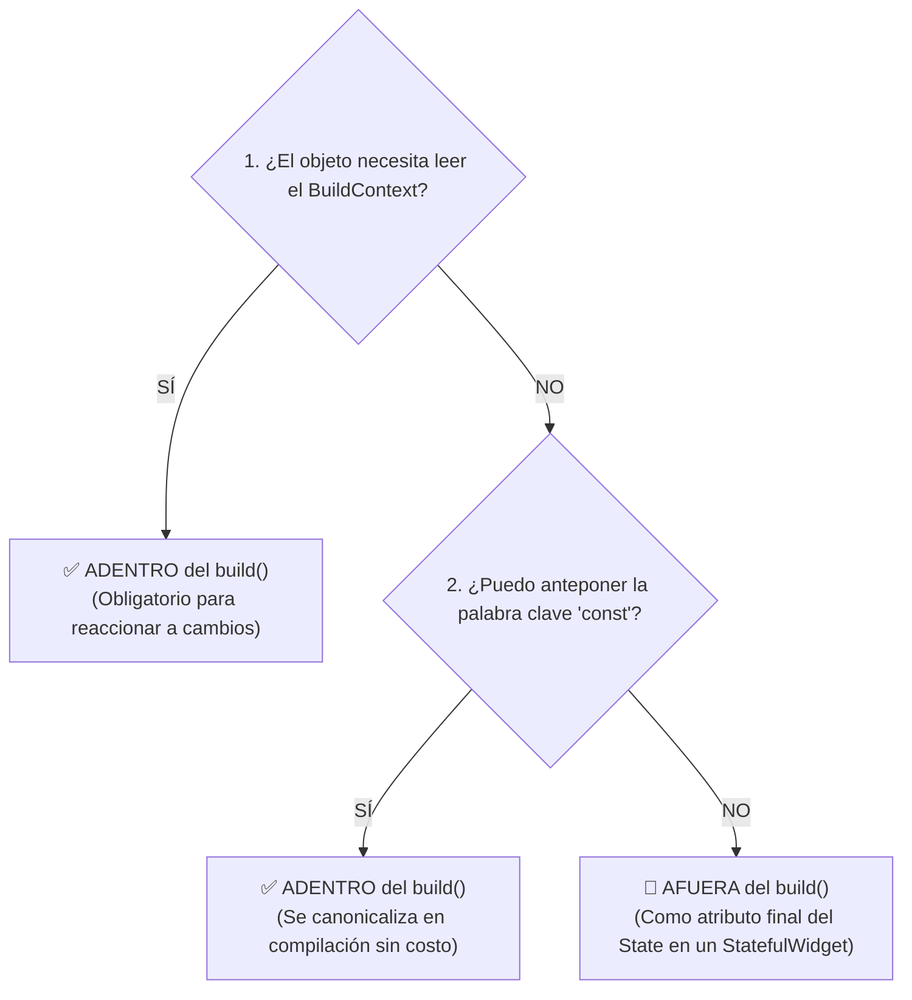

# ⚡ Reglas de Rendimiento: ¿Dentro o Fuera del Método `build`?

Para evitar reconstrucciones costosas en la interfaz de usuario, sobrecarga innecesaria en el Garbage Collector y desperdicio de memoria RAM, todo el equipo debe aplicar este **árbol de decisión de 3 preguntas** antes de instanciar cualquier objeto, decoración o variable en un Widget.

---

## 🌳 Árbol de Decisión (3 Preguntas Clave)



### 1. ¿El objeto necesita leer el `BuildContext`?
* **SÍ:** Va **ADENTRO** del `build()` obligatoriamente. Si lo sacas, la app no reaccionará a los cambios de tema, tamaño de pantalla o configuración del sistema.
  - *Ejemplos:* `Theme.of(context).colorScheme`, `MediaQuery.of(context).size`, `Localizations.of(...)`.
* **NO:** Pasa a la pregunta 2.

---

### 2. ¿Puedo anteponer la palabra clave `const` al objeto?
* **SÍ:** Va **ADENTRO** del `build()`. Flutter lo instancia una única vez en tiempo de compilación (canonicalización) y lo reutiliza de forma gratuita en memoria en cada redibujado, con cero impacto de rendimiento.
  - *Ejemplos:* `const SizedBox(height: 10)`, `const Padding(...)`, `const TextStyle(color: Colors.white)`.
* **NO:** Pasa a la pregunta 3.

---

### 3. No usa `BuildContext` y NO puede ser `const`. ¿Qué hago?
* **VEREDICTO:** Va **AFUERA** del `build()`, como un atributo `final` de la clase `State` (requiere usar un `StatefulWidget`).
  - *Razón:* Si lo dejas dentro del `build()`, Flutter creará una instancia completamente nueva en cada frame de animación o cada pulsación de tecla, saturando el recolector de basura.
  - *Ejemplos:* `TextEditingController`, `FocusNode`, `ScrollController`, `AnimationController`, decoraciones complejas o bordes calculados en runtime.

---

## 💡 Hack de Optimización: El caso de `BorderRadius`

Muchos métodos utilitarios populares como `BorderRadius.circular()` no son constructores constantes en Flutter, lo que nos obligaría a sacarlos del `build()` (Regla 3). 

Sin embargo, si utilizamos su constructor base constante equivalente (`BorderRadius.all`), podemos anteponerle `const` y mantenerlo limpio dentro del `build()` (Regla 2):

```dart
// ❌ MAL (No es const: se recalcula matemáticamente en cada frame)
final border = BorderRadius.circular(80);

// ✅ BIEN (Es const: se resuelve una única vez durante la compilación)
const border = BorderRadius.all(Radius.circular(80));
```

Lo mismo aplica para bordes de inputs (`UnderlineInputBorder`, `OutlineInputBorder`):

```dart
// ❌ MAL (Dentro de build y no es const)
@override
Widget build(BuildContext context) {
  final inputBorder = UnderlineInputBorder(
    borderSide: const BorderSide(color: Colors.transparent),
    borderRadius: BorderRadius.circular(80),
  );
  ...
}

// ✅ BIEN (Opción A: const en build usando constructor base)
@override
Widget build(BuildContext context) {
  const inputBorder = UnderlineInputBorder(
    borderSide: BorderSide(color: Colors.transparent),
    borderRadius: BorderRadius.all(Radius.circular(80)),
  );
  ...
}

// ✅ BIEN (Opción B: Si no puede ser const, se extrae como atributo final en State)
class _MessageFieldBoxState extends State<MessageFieldBox> {
  final _outlineInputBorder = UnderlineInputBorder(
    borderSide: const BorderSide(color: Colors.transparent),
    borderRadius: BorderRadius.circular(80),
  );
  ...
}
```

---

## 📊 Tabla Resumen de Decisión Rápida

| Elemento | ¿Usa Context? | ¿Es `const`? | ¿Dónde se declara? |
|---|:---:|:---:|---|
| `Theme.of(context)` / `MediaQuery` | **SÍ** | No | **Dentro del `build()`** |
| Widgets inmutables (`const SizedBox`) | No | **SÍ** | **Dentro del `build()`** |
| `BorderRadius.all(Radius.circular(...))` | No | **SÍ** | **Dentro del `build()`** |
| Controladores (`TextEditingController`, `FocusNode`) | No | No | **Fuera del `build()` (en `State` con `dispose()`)** |
| Decoraciones no constantes complejas | No | No | **Fuera del `build()` (atributo `final` en `State`)** |
